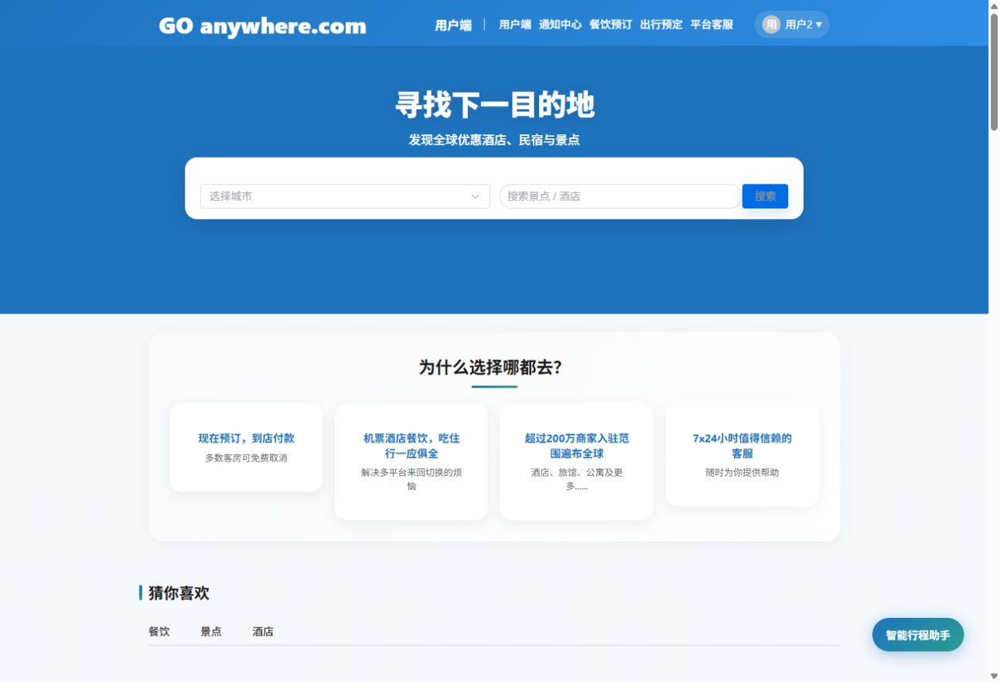
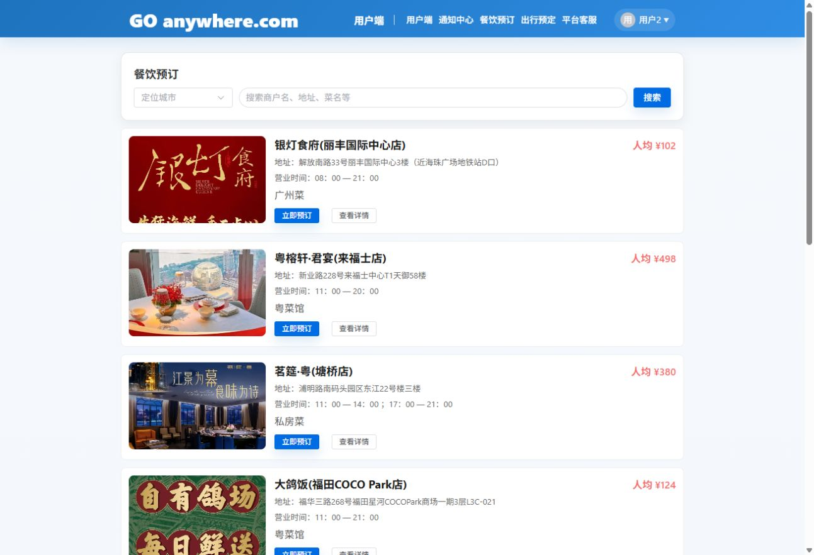
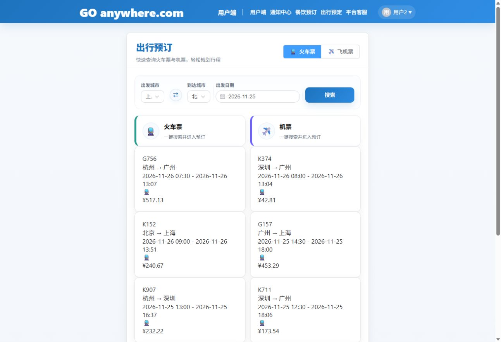
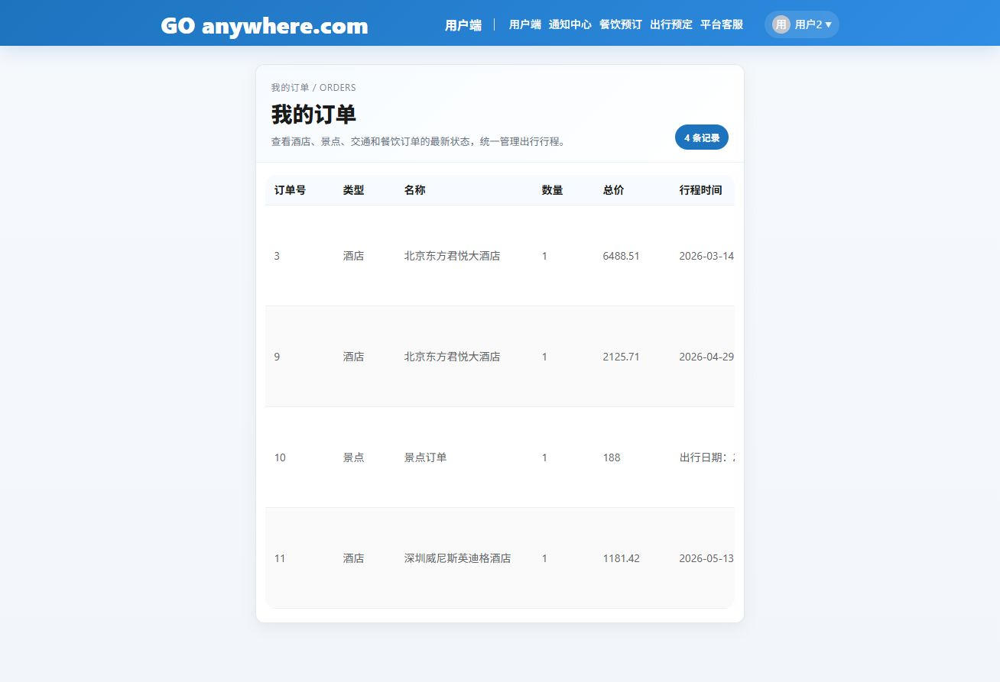
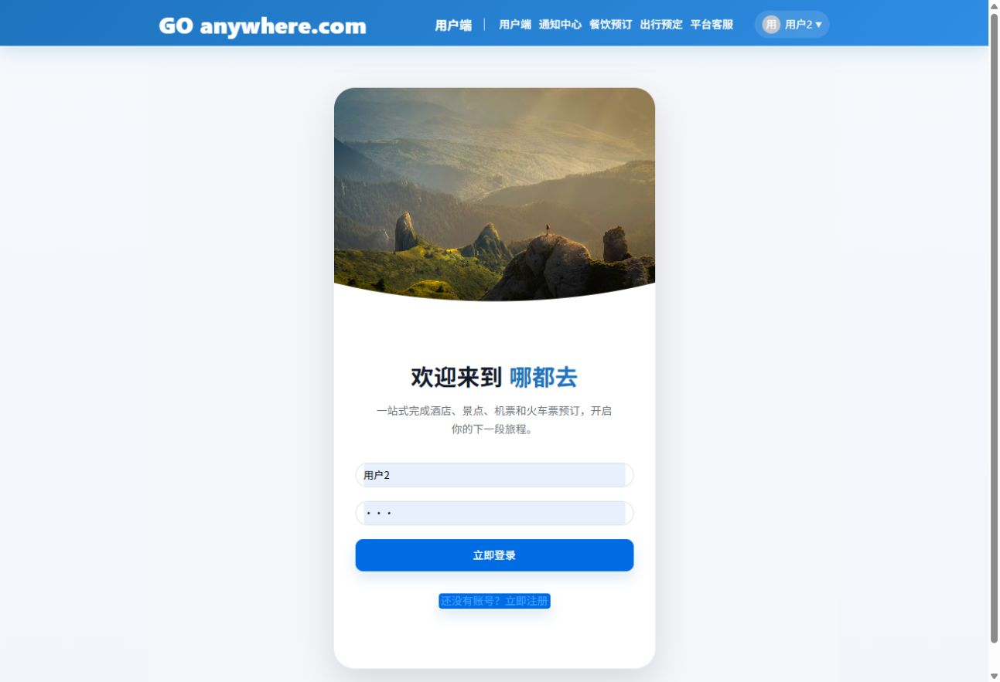

# 哪都去 · 综合旅游服务平台

一个面向**游客、商家和管理员**的综合旅游服务平台，将酒店、景点、机票、火车票和餐饮预订整合到同一个系统中。用户可以搜索旅游产品、完成预订、管理订单并进行收藏、评论和客服咨询；商家可以维护自己的旅游、出行或餐饮资源；管理员可以审核商家和平台资源。

> 本项目采用 Vue 3 + Spring Boot + MySQL 的前后端分离架构，适合作为课程设计、毕业设计、全栈学习和二次开发项目。



## 项目功能

### 游客端

- 注册、登录和 JWT 身份认证
- 按城市搜索酒店、景点和餐饮店铺
- 查询火车票和机票，提交订单
- 酒店、景点、餐饮、机票和火车票预订
- 我的订单、取消申请和行程状态查看
- 收藏、评论、优惠券和通知中心
- 餐饮团购、预约和核销
- 智能旅游客服和行程推荐

### 商家端

- 旅游商家管理景点和酒店
- 出行商家管理航班和火车班次
- 餐饮商家管理店铺、推荐菜和团购套餐
- 查看订单、预约、评价和消息通知
- 处理订单状态与核销流程

### 管理员端

- 审核商家、景点、酒店和餐饮店铺
- 启用、禁用和删除平台资源
- 管理城市数据
- 查看和处理平台业务数据

## 界面预览

| 餐饮预订 | 出行预订 |
| --- | --- |
|  |  |

| 我的订单 | 登录注册 |
| --- | --- |
|  |  |

## 技术栈

| 模块 | 技术 |
| --- | --- |
| 前端 | Vue 3、Vue Router、Element Plus、Axios、Vite |
| 后端 | Java 17、Spring Boot 3.3、Spring Security、Spring Data JPA、JWT |
| 数据库 | MySQL 8 |
| 构建工具 | Maven 3.9+、npm |
| 自动构建 | GitHub Actions |

## 项目结构

```text
travel-platform/
├── .github/workflows/ci.yml   # 前后端自动构建
├── backend/                   # Spring Boot 后端
│   ├── src/main/java/         # Java 业务代码
│   ├── src/main/resources/    # application.yml
│   └── uploads/               # 运行时上传目录
├── frontend/                  # Vue 3 前端
│   ├── src/views/             # 用户、商家和管理员页面
│   ├── src/components/        # 公共组件
│   └── src/router/            # 前端路由
├── database/schema.sql        # MySQL 表结构
├── docs/DEPLOYMENT.md         # 部署说明
├── docs/screenshots/          # README 界面截图
└── README.md
```

## 下载项目

### 方式一：直接下载 ZIP

1. 打开 [GitHub 仓库](https://github.com/leeink12-oss/Intern-Product-Library)。
2. 点击绿色 `Code` 按钮。
3. 选择 `Download ZIP`。
4. 解压后进入项目根目录。

### 方式二：使用 Git 克隆

```bash
git clone https://github.com/leeink12-oss/Intern-Product-Library.git
cd Intern-Product-Library
```

## 安装环境

请先安装以下软件：

| 软件 | 建议版本 |
| --- | --- |
| JDK | 17 或 21 |
| Maven | 3.9+ |
| Node.js | 20+ |
| MySQL | 8.0+ |
| Git | 最新版 |

检查安装结果：

```bash
java -version
mvn -version
node -v
npm -v
mysql --version
```

> 项目编译目标为 Java 17。使用 JDK 21 可以正常运行，但在 IntelliJ IDEA 中必须把项目语言级别和模块语言级别设为 17。

## 本地安装与启动

### 1. 创建数据库

打开 MySQL 客户端并执行：

```sql
CREATE DATABASE nadouqu
  CHARACTER SET utf8mb4
  COLLATE utf8mb4_0900_ai_ci;
```

默认情况下，Spring Data JPA 会通过 `ddl-auto=update` 自动创建表。如果需要预先建立固定表结构，也可以导入：

```bash
mysql -u root -p nadouqu < database/schema.sql
```

`schema.sql` 只包含表结构，不包含用户、订单、联系方式等原始业务数据。

### 2. 配置后端环境变量

后端配置模板位于 [`backend/.env.example`](backend/.env.example)。在 PowerShell 中为当前终端设置：

```powershell
$env:DB_URL = "jdbc:mysql://localhost:3306/nadouqu?useUnicode=true&characterEncoding=utf-8&serverTimezone=Asia/Shanghai"
$env:DB_USERNAME = "root"
$env:DB_PASSWORD = "你的数据库密码"
$env:JWT_SECRET = "至少32位的随机密钥"
$env:ADMIN_PASSWORD = "你设置的管理员密码"
$env:SPARK_API_PASSWORD = "你的星火API凭证"
```

星火 API 用于智能客服和行程助手；不配置时其他功能仍然可以使用，但智能问答会提示未配置。

### 3. 启动后端

```powershell
cd backend
mvn spring-boot:run
```

启动成功后，后端默认地址为：

```text
http://localhost:8080
```

### 4. 启动前端

另开一个终端，在项目根目录执行：

```powershell
cd frontend
npm install
npm run dev
```

浏览器打开：

```text
http://localhost:5173
```

前端开发服务器会把 `/api` 和 `/uploads` 请求代理到 `http://localhost:8080`。

## 默认账号

后端首次启动时会初始化管理员账号：

- 用户名：`admin`
- 密码：环境变量 `ADMIN_PASSWORD` 的值
- 未设置 `ADMIN_PASSWORD` 时，本地默认密码为 `admin123`

普通用户和商家账号可以在注册页面创建。**正式部署前必须修改管理员默认密码。**

## 环境变量

| 变量 | 必填 | 默认值 | 说明 |
| --- | --- | --- | --- |
| `SERVER_PORT` | 否 | `8080` | 后端监听端口 |
| `DB_URL` | 否 | 本地 `nadouqu` 数据库 | JDBC 连接地址 |
| `DB_USERNAME` | 否 | `root` | MySQL 用户名 |
| `DB_PASSWORD` | 是 | 空 | MySQL 密码 |
| `JWT_SECRET` | 是 | 无 | JWT 签名密钥，至少 32 个字符 |
| `JWT_EXPIRATION` | 否 | `86400000` | 登录令牌有效期，单位毫秒 |
| `ADMIN_PASSWORD` | 生产必填 | `admin123` | 初始化管理员密码 |
| `SPARK_API_PASSWORD` | 否 | 空 | 科大讯飞星火 API 凭证 |
| `DDL_AUTO` | 否 | `update` | 生产环境建议改为 `validate` |
| `SHOW_SQL` | 否 | `false` | 是否输出 SQL 日志 |
| `VITE_API_BASE_URL` | 否 | `/api` | 前端 API 基础路径 |
| `VITE_API_PROXY_TARGET` | 否 | `http://localhost:8080` | 开发代理目标 |

不要将真实密码、JWT 密钥或第三方 API 凭证提交到 GitHub。

## 构建项目

### 构建后端

```powershell
cd backend
mvn clean package
```

构建完成后生成：

```text
backend/target/nadouqu-backend-1.0.0-SNAPSHOT.jar
```

运行：

```powershell
java -jar target/nadouqu-backend-1.0.0-SNAPSHOT.jar
```

### 构建前端

```powershell
cd frontend
npm install
npm run build
```

构建结果位于 `frontend/dist/`。

## 部署

生产环境需要分别部署：

1. MySQL 8 数据库；
2. Spring Boot 后端服务；
3. `frontend/dist` 静态文件；
4. Nginx 或 HTTPS 反向代理。

推荐让前端和后端共用同一个域名，将 `/api/` 和 `/uploads/` 转发到 Spring Boot，避免额外的跨域配置。

完整的服务器配置、环境变量和 Nginx 示例参见 [部署文档](docs/DEPLOYMENT.md)。

## 常见问题

### 1. 前端无法请求后端

确认以下地址都可以访问：

```text
http://localhost:8080
http://localhost:5173
```

检查 `frontend/.env` 中的 `VITE_API_PROXY_TARGET` 是否指向正确的后端地址。

### 2. 数据库连接失败

确认 MySQL 已启动、数据库 `nadouqu` 已创建，并检查：

```text
DB_URL
DB_USERNAME
DB_PASSWORD
```

### 3. IntelliJ 报错“不支持发行版本 22”

这是 IDE 语言级别配置错误。项目要求 Java 17，请检查：

- `Project Structure → Project → SDK`：JDK 17 或 21
- `Project Structure → Project → Language level`：17
- `Project Structure → Modules → nadouqu-backend`：Language level 17
- `Settings → Build, Execution, Deployment → Compiler → Java Compiler`：Target bytecode version 17

然后重新加载 Maven 项目并执行 `Build → Rebuild Project`。

### 4. 图片上传后重新部署就消失

`backend/uploads/` 属于运行时文件目录。Docker、Railway、Render 等平台的临时文件系统会在重新部署后清空，生产环境应挂载持久化磁盘或改用对象存储。

### 5. 页面没有完整演示数据

公开仓库不包含原始数据库中的用户、订单、评论和联系方式。可以导入自己的脱敏数据，或通过注册商家账号后在商家端创建资源。

## 安全说明

- `.env`、数据库密码、JWT 密钥和第三方 API 凭证均已排除在 Git 跟踪范围之外。
- 数据库脚本只提供表结构。
- 运行时的用户上传图片不会提交到仓库。
- 如果曾经公开过真实密钥，应立即在对应平台重新生成。

## 参与贡献

欢迎提交 Issue 或 Pull Request。提交前请确保：

1. 前端可以通过 `npm run build`；
2. 后端可以通过 `mvn clean package`；
3. 没有提交 `.env`、账号密码、真实用户数据或本地上传文件。

## 仓库

- GitHub：<https://github.com/leeink12-oss/Intern-Product-Library>
- 本地前端：`http://localhost:5173`
- 本地后端：`http://localhost:8080`
